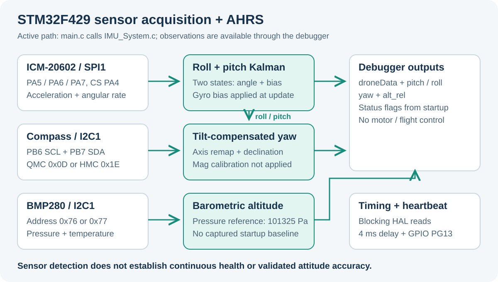

# STM32F429 - IMU Acquisition and AHRS

STM32 HAL firmware for ICM-20602 acquisition, roll/pitch filtering, tilt-compensated compass heading, and BMP280 barometric estimates.

[English](#english) | [Tiếng Việt](#tieng-viet)



<a id="english"></a>

## English

This project implements the sensing and estimation portion of a custom flight-controller experiment. The active application combines an ICM-20602 accelerometer/gyroscope, a QMC5883L or HMC5883L magnetometer, and a BMP280 pressure sensor into an `IMU_Data_t` structure that can be inspected in STM32CubeIDE.

**It is an AHRS development prototype.** The source does not contain motor mixing, ESC output, a closed-loop flight controller, a receiver interface, or a ground-station telemetry protocol. Sensor accuracy and flight readiness are not established by this repository.

### Implemented pipeline

| Stage | Current behavior |
| --- | --- |
| ICM startup | Checks `WHO_AM_I == 0x12`, resets/configures the chip, uses SPI reads |
| Gyro calibration | Averages 200 samples and applies the resulting bias to angular-rate data |
| Roll and pitch | Separate two-state Kalman filters combine accelerometer tilt and gyro rate |
| Compass selection | Probes QMC at `0x0D` first, then HMC at `0x1E` |
| Yaw | Remaps compass axes, compensates tilt using roll/pitch, adds configured declination |
| BMP280 | Reads factory calibration, compensates temperature/pressure, computes altitude |
| Debug output | Updates `droneData`, `pitch`, `roll`, `yaw`, and `alt_rel`; toggles PG13 |

Magnetometer calibration also collects raw min/max values and calculates offsets/scales. **Those values are not used by the current yaw update.** See the limitations below before interpreting compass results.

### Hardware and pin map

The checked-in `.ioc`, linker scripts, and CubeIDE metadata target **STM32F429ZITx**. The project configures a 25 MHz system clock from HSI + PLL. Porting to a different F429 package or board requires reviewing pin availability, memory layout, clock settings, and debug connections.

| Device / signal | Interface | MCU pin |
| --- | --- | --- |
| ICM-20602 SCK | SPI1 | PA5 |
| ICM-20602 MISO | SPI1 | PA6 |
| ICM-20602 MOSI | SPI1 | PA7 |
| ICM-20602 chip select | Software-controlled GPIO | PA4, active LOW |
| QMC5883L / HMC5883L SCL | I2C1 | PB6 |
| QMC5883L / HMC5883L SDA | I2C1 | PB7 |
| BMP280 SCL / SDA | Shared I2C1 | PB6 / PB7 |
| Activity LED | GPIO output | PG13 |

I2C1 is configured for 100 kHz, 7-bit addressing, open-drain alternate-function pins with **no internal pull-ups**. Provide suitable bus pull-ups and common ground for the sensor modules. Check the actual module's supply and logic requirements before connecting it.

SPI1 uses 8-bit, MSB-first transfers, mode 0, software chip select, and prescaler 2. The `.ioc` reports 3.125 Mbit/s with the current clocks.

| Sensor | Address / configuration in the active code |
| --- | --- |
| ICM-20602 | SPI; ±8 g acceleration, ±2000 °/s gyro, DLPF register value `0x03` |
| QMC5883L | 7-bit I2C address `0x0D` |
| HMC5883L | 7-bit I2C address `0x1E`; selected if QMC does not respond |
| BMP280 | Probes `0x76`, then `0x77` |

The HAL calls shift I2C addresses left by one. Use the unshifted addresses above when checking the bus with a 7-bit-address tool.

### Source map

All firmware lives in [ICM20602_F429_1132026](ICM20602_F429_1132026).

| File | Role |
| --- | --- |
| [main.c](ICM20602_F429_1132026/Core/Src/main.c) | Peripheral setup, startup calibration, timing, debug variables |
| [IMU_System.c](ICM20602_F429_1132026/Core/Src/IMU_System.c) | Active integrated sensor routines, fusion, and compensation |
| [IMU_System.h](ICM20602_F429_1132026/Core/Inc/IMU_System.h) | Public data types, API, chip select, declination |
| [stm32f4xx_hal_msp.c](ICM20602_F429_1132026/Core/Src/stm32f4xx_hal_msp.c) | SPI/I2C alternate-function pin setup |
| [ICM20602.c](ICM20602_F429_1132026/Core/Src/ICM20602.c) | Separate ICM driver implementation retained in the project |
| [hmc5883l.c](ICM20602_F429_1132026/Core/Src/hmc5883l.c) | Separate HMC driver and level-compass calculation |
| [CubeMX configuration](ICM20602_F429_1132026/ICM20602_F429_1132026.ioc) | MCU and peripheral configuration |

`main.c` calls `IMU_Init`, `IMU_Calibrate_Gyro`, `IMU_Calibrate_Mag`, and `IMU_Update` from `IMU_System.c`. The separate sensor driver files are not the acquisition path used by this main loop; editing them alone will not change the integrated estimator.

### Import and build

Requirements: STM32CubeIDE with its ARM toolchain, the supplied STM32 HAL/CMSIS sources, and an ST-Link for hardware debugging. The `.ioc` records `STM32Cube FW_F4 V1.28.3`; no exact CubeIDE version is pinned.

1. Clone the repository:

   ```bash
   git clone https://github.com/TuanLinh05/STM32F429-IMU-AHRS.git
   ```

2. In CubeIDE, use **File > Import > General > Existing Projects into Workspace** and select `ICM20602_F429_1132026`, which contains `.project` and `.cproject`.
3. Review the target MCU, selected build configuration, and linker script; build with **Project > Build Project**.
4. For a connected, correctly wired board, use the supplied debug launch or configure an ST-Link debug session for the actual board. Keep sensors accessible during the startup calibration sequence.
5. Inspect Live Expressions after the application reaches its main loop.

Regenerating from `.ioc` can change generated code. Review the resulting diff and preserve the user-code sections and custom sensor files. The repository does not provide a top-level Makefile or a prebuilt firmware image; build artifacts are ignored by Git.

### Startup sequence and timing

The application runs this sequence on every reset:

1. Initialize HAL, clock, GPIO, SPI1, and I2C1; drive PA4 HIGH and wait 100 ms.
2. Detect and configure the available sensors.
3. Toggle PG13 quickly, then acquire 200 gyro samples with a 2 ms delay per sample. Keep the IMU still for this stage.
4. Hold the LED HIGH for 1 s, then toggle it more slowly before magnetometer calibration.
5. If a compass was detected, collect 1000 raw samples with a 10 ms delay per sample. Rotate it through the axes to populate the min/max values. This stage takes at least about 10 s plus bus time.
6. Enter the loop: derive `dt` from `HAL_GetTick()`, update sensors/estimates, copy debug variables, toggle PG13, and delay 4 ms.

The 4 ms delay expresses an intended loop pace; blocking SPI/I2C reads, calculation, and timeouts add to it. There is no timer-driven 250 Hz scheduler or measured timing guarantee. Tick-based `dt` has millisecond resolution.

### Debug variables and units

| Expression | Meaning / units |
| --- | --- |
| `droneData.Status_ICM` | ICM detected at startup |
| `droneData.Status_Mag` | A supported compass address responded at startup |
| `droneData.Status_Baro` | A supported pressure-sensor address responded at startup |
| `droneData.Ax`, `Ay`, `Az` | Acceleration in g; Z retains gravity |
| `droneData.Gx`, `Gy`, `Gz` | Bias-corrected angular rate in °/s |
| `droneData.Roll`, `Pitch` | Kalman angle estimates in degrees |
| `droneData.Mx`, `My`, `Mz` | Scaled and remapped magnetic readings |
| `droneData.Yaw` | Tilt-compensated compass angle, normalized to `[0, 360)` degrees |
| `droneData.Pressure` | Compensated pressure in Pa |
| `droneData.Temperature` | BMP280 temperature in °C |
| `droneData.Altitude` | Barometric altitude using a fixed 101325 Pa reference |
| `pitch`, `roll`, `yaw`, `alt_rel` | Convenience globals copied by `main.c` |
| `calib` | Gyro biases and calculated magnetometer offsets/scales |

The source includes `stdio.h` but does not transmit these values over UART or USB. Live Expressions require a functioning debug session and suitable compiler/debug settings.

### Current limitations

- `IMU_Init()` returns `1` even when sensors are missing. Use the individual status flags to identify which branches initialized.
- Status flags are copied from startup detection flags. They are not refreshed by checking each runtime transfer, so disconnecting a detected sensor can leave its status at `1`.
- Most HAL transfer return values are ignored. Read failures can therefore invalidate data without a corresponding reported error. Peripheral initialization errors can still enter `Error_Handler()`.
- Magnetometer offsets/scales are calculated from raw readings, but `IMU_Update()` does not apply them. Its comments acknowledge the raw/scaled/remapped-unit mismatch. The calibration routine also lacks a guard against a zero axis range.
- Calibration values are RAM globals; the code does not persist them in flash. Accelerometer X/Y biases remain their default zeros unless supplied separately.
- `start_altitude` is initialized to `0.0f` and never captured from the sensor. Consequently, `alt_rel` currently equals `droneData.Altitude`, rather than height relative to startup.
- Compass declination is fixed at `-1.0f` in `IMU_System.h`, and yaw is a compass calculation rather than a fused gyro yaw estimate. Sensor mounting, axis conventions, local declination, and magnetic interference need validation.

Missing sensors skip their update branches. Continuing execution after a failed detection should not be interpreted as providing valid estimates for the missing measurement.

### Credits and licensing

Custom sensor code identifies [Vu Tuan Linh](https://github.com/TuanLinh05) as author. Generated STM32 files and bundled libraries retain STMicroelectronics and Arm notices. Component terms are included under [STM32 HAL](ICM20602_F429_1132026/Drivers/STM32F4xx_HAL_Driver/LICENSE.txt), [CMSIS](ICM20602_F429_1132026/Drivers/CMSIS/LICENSE.txt), and [STM32 device support](ICM20602_F429_1132026/Drivers/CMSIS/Device/ST/STM32F4xx/LICENSE.txt). No separate top-level project license is provided.

<a id="tieng-viet"></a>

## Tiếng Việt

Repo là phần thu thập cảm biến và ước lượng tư thế trong thử nghiệm flight controller dùng STM32F429. Mã hiện tại đọc ICM-20602, tự chọn QMC5883L/HMC5883L, đọc BMP280 và lưu kết quả vào `IMU_Data_t` để xem bằng debugger.

**Đây là prototype AHRS.** Repo chưa có bộ điều khiển bay kín, trộn động cơ, tín hiệu ESC, giao tiếp tay điều khiển hay telemetry đến trạm mặt đất. Chưa có dữ liệu xác nhận độ chính xác tư thế hoặc khả năng bay.

### Phần cứng và build

Project cấu hình **STM32F429ZITx**, clock hệ thống 25 MHz. ICM dùng SPI1: PA5 SCK, PA6 MISO, PA7 MOSI, PA4 CS chủ động LOW. La bàn và BMP280 dùng chung I2C1: PB6 SCL, PB7 SDA; LED hoạt động ở PG13.

I2C là 100 kHz, GPIO open-drain không bật pull-up nội. Kiểm tra pull-up, mức điện áp của module và GND chung. Địa chỉ 7-bit: QMC `0x0D`, HMC `0x1E`, BMP280 `0x76` hoặc `0x77`; HAL dùng địa chỉ đã dịch trái một bit. SPI mode 0, 8-bit, MSB trước; `.ioc` ghi tốc độ 3.125 Mbit/s.

1. Clone repo; mở **File > Import > General > Existing Projects into Workspace** trong STM32CubeIDE.
2. Chọn `ICM20602_F429_1132026`, kiểm tra MCU/linker và build project.
3. Khi dùng board đúng cấu hình, tạo phiên debug ST-Link và xem Live Expressions.
4. Nếu sinh lại mã từ `.ioc`, kiểm tra diff và giữ các vùng user code cùng file cảm biến tự viết.

HAL/CMSIS đã có trong repo; `.ioc` ghi firmware package F4 V1.28.3, chưa khóa phiên bản CubeIDE. Không có Makefile tổng hoặc firmware dựng sẵn ở thư mục gốc.

### Luồng chạy và quan sát

`main.c` sử dụng các hàm trong [IMU_System.c](ICM20602_F429_1132026/Core/Src/IMU_System.c). Hai file driver `ICM20602.c` và `hmc5883l.c` được giữ riêng, nhưng không phải đường đọc cảm biến của vòng lặp chính.

Mỗi lần reset: khởi tạo ngoại vi, phát hiện cảm biến, hiệu chuẩn gyro 200 mẫu khi board đứng yên, rồi hiệu chuẩn la bàn 1000 mẫu nếu có. Giai đoạn la bàn có delay 10 ms/mẫu, mất ít nhất khoảng 10 giây cộng thời gian I2C. Sau đó vòng lặp lấy `dt` từ tick, cập nhật dữ liệu, chép biến toàn cục và delay 4 ms. Đây là nhịp dự kiến, không phải bộ lập lịch 250 Hz hoặc hiệu năng đã đo.

Quan sát `droneData` hoặc `pitch`, `roll`, `yaw`, `alt_rel`: góc tính bằng độ, gia tốc bằng g, gyro bằng °/s, áp suất bằng Pa, nhiệt độ bằng °C. Bảng biến đầy đủ ở phần tiếng Anh. Chưa có lệnh xuất UART/USB trong main.

### Những giới hạn cần hiểu

- Roll/pitch dùng Kalman hai trạng thái; yaw dùng la bàn bù nghiêng với declination cố định `-1.0f`.
- `Status_ICM`, `Status_Mag`, `Status_Baro` phản ánh phát hiện lúc khởi động, chưa kiểm tra sức khỏe cảm biến liên tục. `IMU_Init()` vẫn trả về `1` khi thiếu cảm biến.
- Phần lớn giá trị trả về HAL chưa được xử lý; lỗi đọc có thể không làm cờ trạng thái đổi.
- Hàm calib la bàn có tính offset/scale, nhưng **chưa áp dụng vào `IMU_Update()`**. Chưa chặn trường hợp khoảng min/max của trục bằng 0.
- Giá trị hiệu chuẩn chỉ ở RAM, không lưu flash; bias gia tốc X/Y mặc định bằng 0.
- `start_altitude` luôn bằng 0 nên `alt_rel` hiện chưa là độ cao tương đối lúc khởi động. Áp suất chuẩn của công thức độ cao cố định 101325 Pa.
- Cần kiểm chứng hướng lắp, quy ước trục, nhiễu từ và dữ liệu thực trước khi dùng kết quả cho điều khiển.

Tác giả mã cảm biến: [Vu Tuan Linh](https://github.com/TuanLinh05). Giữ nguyên thông báo giấy phép ST/Arm trong mã sinh và thư viện; repo chưa có giấy phép dự án riêng ở thư mục gốc.
